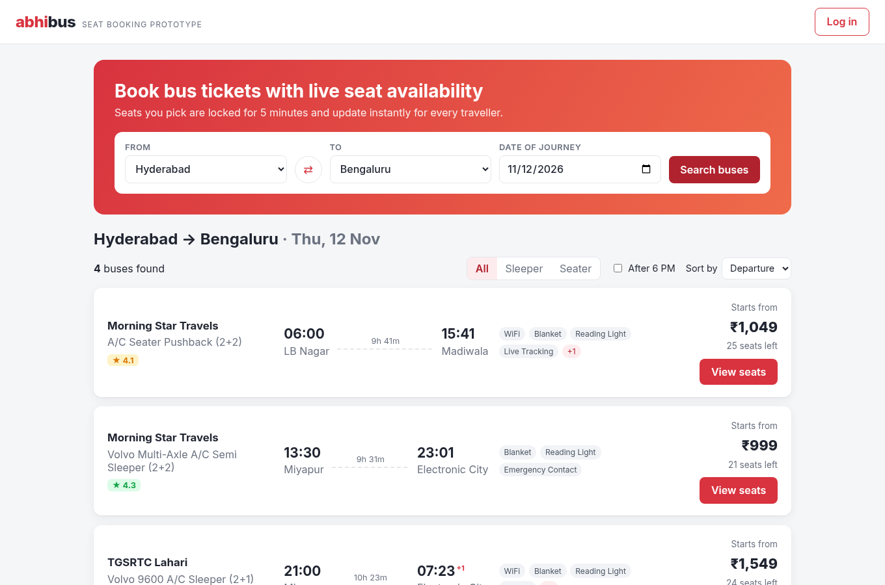
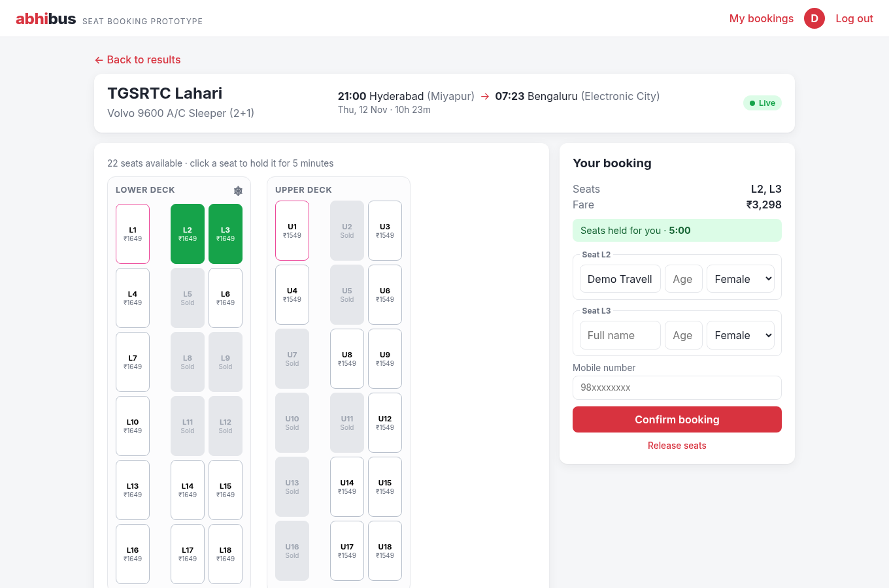
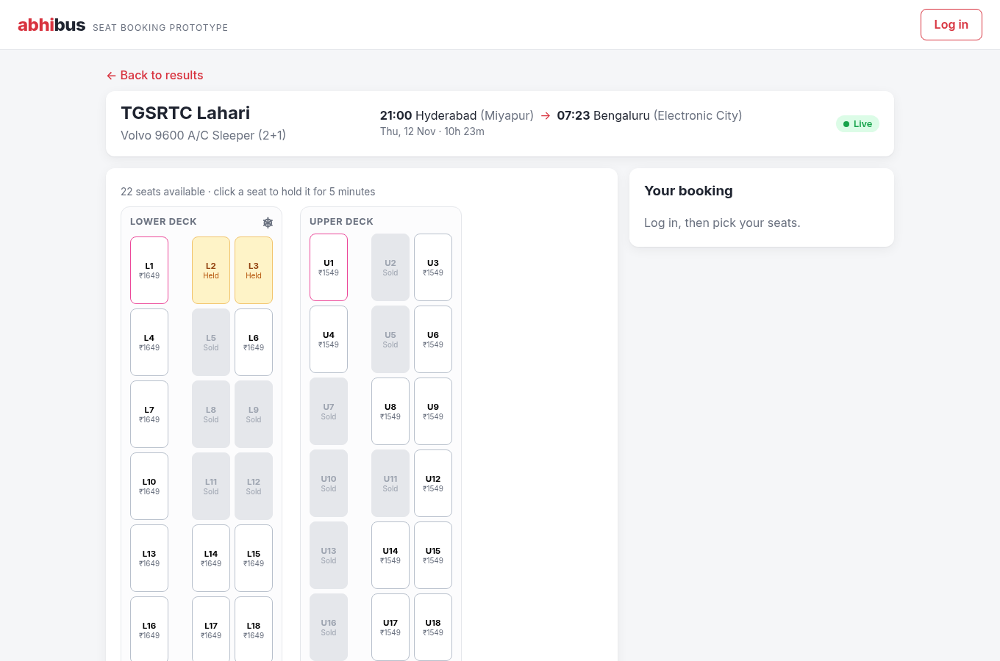
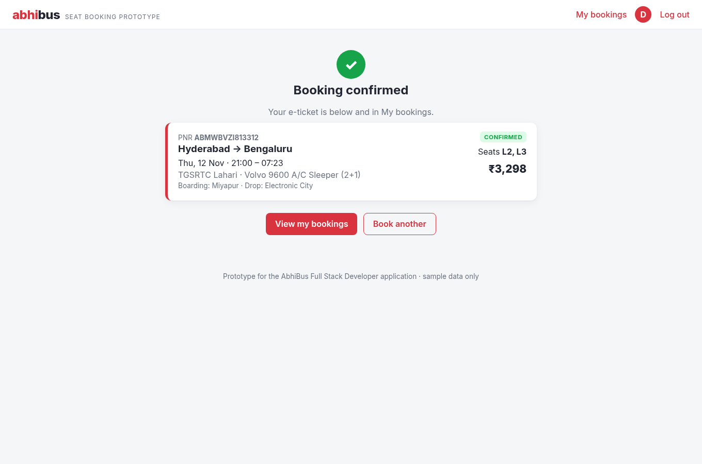
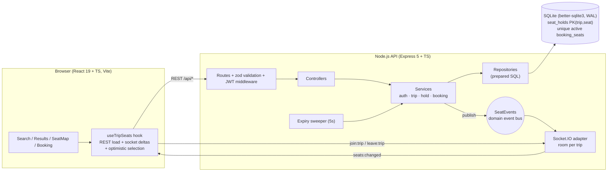

# AbhiBus Seat Booking: a real-time bus booking prototype (React + Node)

A small full-stack app for **bus search and seat booking with live seat locking**. I built it for the AbhiBus (ixigo) *Full Stack Developer (Node.js & React.js)* application.

* Search buses by route and date, then filter and sort the results (type, departure time, fare, rating, duration).
* Pick seats on a **sleeper (2+1, lower and upper deck)** or **seater (2+2)** layout.
* The seats you pick are **held for 5 minutes** (with a TTL and a countdown). Everyone else viewing the same bus sees them change **instantly over WebSockets**.
* Concurrent hold requests are **atomic**, so a seat can never be held or booked twice. Tests cover this, including a multi-thread race test.
* JWT login, passenger details, booking confirmation, My bookings, and cancellation with a refund policy.

> Sample data only: 8 popular South-India routes (Hyderabad ⇄ Bengaluru, Hyderabad ⇄ Vijayawada, Hyderabad → Chennai / Visakhapatnam / Tirupati, Bengaluru → Chennai) seeded for the next 14 days.
> The operator names are used only to make the data look realistic.

| Search results | Seat hold (tab A) | Same bus, live in tab B | Confirmed |
|---|---|---|---|
|  |  |  |  |

---

## Quick start

Requires **Node 20+** (developed on Node 24). Nothing else is needed, because the database is an embedded SQLite file that is created and seeded on first start.

```bash
npm install
npm run dev
```

* App: http://localhost:5173 (Vite, which proxies `/api` and `/socket.io` to the API)
* API: http://localhost:4000/api
* Demo login: **demo@abhibus.test / demo1234** (pre-filled in the login dialog). You can also sign up.

To see the real-time behaviour, open the same bus in two browser windows (one normal, one incognito) and pick a seat in one of them.

| Command | What it does |
|---|---|
| `npm run dev` | API (tsx watch) and client (Vite) together |
| `npm test` | Server tests (24), then client tests (13) |
| `npm run typecheck` | `tsc` for both workspaces, including test files |
| `npm run build && npm start` | Production build; Express serves the built SPA and the API on :4000 |
| `BASE=http://localhost:4000 ./scripts/smoke.sh` | End-to-end curl walkthrough of the API ([sample output](docs/api-smoke-output.txt)) |

### Docker

```bash
docker compose up --build      # http://localhost:4000
```

This is a multi-stage image: it builds everything, then ships only the production dependencies and the compiled output. It runs as the non-root `node` user, has a healthcheck, and keeps SQLite on a named volume.
*Note: the box this was built on had no Docker daemon, so I could not run `docker build`. I did run the exact Dockerfile commands (`npm ci --ignore-scripts`, `npm run build`, `npm ci --omit=dev -w server`, then starting `server/dist/index.js` with `STATIC_DIR`) in a clean directory, and the smoke test passed against that.*

Environment variables: `PORT` (4000), `JWT_SECRET`, `HOLD_TTL_MS` (300000), `DB_FILE` (`abhibus.db`), `CORS_ORIGIN` (`*`), `STATIC_DIR`.

---

## Architecture



### Hold → book sequence

```mermaid
sequenceDiagram
  participant A as Tab A (logged in)
  participant API
  participant DB as SQLite
  participant B as Tab B (same bus)
  A->>API: POST /trips/42/holds {seats:[L2,L3]}
  API->>DB: BEGIN IMMEDIATE; release A's old hold; check booked; delete expired; INSERT seat_holds (PK trip,seat)
  DB-->>API: COMMIT (or PK violation → ROLLBACK → 409)
  API-->>A: 201 {holdId, expiresAt}
  API-)B: seats:changed [L2:HELD, L3:HELD]
  A->>API: POST /bookings {holdId, passengers, phone}
  API->>DB: BEGIN IMMEDIATE; verify hold owner + not expired; INSERT booking + booking_seats; DELETE hold
  API-->>A: 201 booking (PNR)
  API-)B: seats:changed [L2:BOOKED, L3:BOOKED]
```

### Code layout

```
server/src
  routes/         URL → middleware chain (auth, zod validate) → controller
  controllers/    thin HTTP adapters, no business logic
  services/       auth, trip (search + seat map), hold (atomic locking + TTL), booking (confirm/cancel/refund)
  repositories/   all SQL lives here (prepared statements)
  realtime/       SeatEvents (domain event bus) + Socket.IO adapter
  db/             schema/migrations + deterministic seed
  container.ts    composition root (tests inject a fake clock + short TTL)
server/tests      holds, bookings, concurrency (HTTP + worker_threads), API + Socket.IO
client/src
  hooks/          useTripSeats (REST + socket + optimistic selection), useCountdown
  components/     SearchForm, TripResults/TripCard, SeatMap, PassengerForm, HoldTimer, ...
  context/        AuthContext (JWT in localStorage)
  __tests__/      component and hook tests (Testing Library, jsdom)
```

---

## API

Base path `/api`. Errors always look like `{ "error": { "code", "message", "details?" } }`. 🔒 means the endpoint needs `Authorization: Bearer <jwt>`.

| Method | Path | Description |
|---|---|---|
| GET | `/health` | Liveness |
| POST | `/auth/register` | `{name, email, password}` → `201 {token, user}`; `409 EMAIL_TAKEN` |
| POST | `/auth/login` | `{email, password}` → `{token, user}`; `401 INVALID_CREDENTIALS` |
| GET 🔒 | `/auth/me` | Current user |
| GET | `/cities` | `{cities[], routes[]}` |
| GET | `/trips/search?from=&to=&date=YYYY-MM-DD` | Trips with `availableSeats`, `minFare`, amenities, rating. Buses that already departed are hidden. `400` on bad input |
| GET | `/trips/:tripId` | `{trip, seats[], myHold}`. Each seat has `status: AVAILABLE \| HELD \| BOOKED` and `heldByYou` (the token is optional here) |
| POST 🔒 | `/trips/:tripId/holds` | `{seats: ["L2","L3"]}` (1–6) → `201 {holdId, seats, expiresAt, totalFare}`. All-or-nothing. **Replaces** your previous hold on this trip. `409 SEAT_UNAVAILABLE`, `409 TRIP_DEPARTED`, `400 INVALID_SEATS` |
| DELETE 🔒 | `/holds/:holdId` | Release your hold (`403` if it is someone else's) |
| POST 🔒 | `/bookings` | `{holdId, contactPhone, passengers:[{seatNo,name,age,gender}]}` → `201 booking`. `410 HOLD_EXPIRED`, `400 PASSENGER_SEAT_MISMATCH`, `400 LADIES_SEAT`, `403` |
| GET 🔒 | `/bookings` | My bookings (newest first) |
| GET 🔒 | `/bookings/:id` | One booking |
| POST 🔒 | `/bookings/:id/cancel` | → booking with `refundAmount` and `refundPercent` |

**WebSocket (Socket.IO):** the client emits `join:trip` / `leave:trip` with a `tripId`, and the server emits `seats:changed` as `{tripId, changes:[{seatNo, status}], at}` to that trip's room only.

**Cancellation policy:** 90% refund 24h or more before departure, 50% between 6 and 24h, no refund under 6h. No cancellation after departure.

---

## Design decisions

1. **The database is the lock.** `seat_holds` has `PRIMARY KEY (trip_id, seat_no)`, and every hold runs in a single `BEGIN IMMEDIATE` transaction: release my old hold, check booked seats, delete expired rows for those seats, then insert. If any insert hits the PK, the whole transaction rolls back and the API returns a clean `409`. A **partial unique index** on `booking_seats(trip_id, seat_no) WHERE active = 1` is a second guarantee: even a buggy code path cannot double-book (there is a test that tries).
2. **Why IMMEDIATE and not the default DEFERRED.** Two connections can both start a deferred transaction, read, and then fail to upgrade to a write lock. The loser then gets a raw SQLite busy error instead of a 409. IMMEDIATE takes the write lock up front, so contenders queue on the busy timeout and then see the committed row. The multi-thread test fails with DEFERRED (I checked by switching it).
3. **TTL is enforced twice.** It is enforced lazily (every read filters `expires_at > now`, and a hold attempt deletes expired rows for the requested seats first). A 5-second sweeper also deletes expired holds and **broadcasts** the freed seats. Correctness never depends on the sweeper, which only makes the UI update promptly.
4. **One hold per user per trip, with replace semantics.** Each click sends the full desired selection. That makes the endpoint idempotent and keeps the client simple: there are no add/remove race conditions on the server.
5. **Domain events are separate from transport.** Services publish to a `SeatEvents` emitter, and the Socket.IO adapter subscribes. To move to multiple instances, you swap the emitter for Redis pub/sub, Kafka, or the Socket.IO Redis adapter without touching the services.
6. **Client concurrency.** `useTripSeats` keeps an optimistic selection in a ref, so rapid clicks build on each other. A request sequence number drops out-of-order responses. Any error triggers a resync from the server, which is the source of truth.
7. **Testable by construction.** `createContainer(db, { now, holdTtlMs })` lets tests control time (TTL expiry, departed buses) without sleeping.
8. **Validation at the edge, with zod.** Controllers only see parsed and typed input. The same rules run on the client (phone, passengers, ladies seats) for UX, and the server stays authoritative.

## Trade-offs and what I'd do for production

| Prototype choice | Why | Production direction |
|---|---|---|
| SQLite (better-sqlite3) | Zero setup, real transactions and constraints, synchronous so it's easy to reason about | MySQL/Postgres with `SELECT … FOR UPDATE SKIP LOCKED` or unique constraints, or a Redis `SET seat NX PX 300000` for holds with the DB as the booking source of truth |
| Single Node process + in-memory event bus | Simplest correct setup | Several instances behind a load balancer, with the Socket.IO Redis adapter or a Kafka `seat-events` topic |
| Full seat-status payload on load, deltas after that | Small payloads (≤40 seats) | Versioned deltas (sequence numbers) so a client that missed events knows to resync |
| JWT in localStorage | Prototype simplicity | httpOnly secure cookie + refresh token rotation + CSRF protection |
| No payment step | Out of scope | Hold → payment intent → webhook confirms booking (idempotency key = holdId) |
| No rate limiting | Out of scope | Per-user and per-IP limits on hold endpoints to stop seat-squatting bots |
| Seat hold replaced on every click | Simple and idempotent | Debounce clicks client-side to cut write volume |

Known limitations: there is no seat-level gender adjacency rule (only ladies-only seats are enforced). There is no admin or operator UI. The mobile layout is responsive but was not tested on real devices.

## Testing

* **Server (24 tests, vitest + supertest + socket.io-client):** holds (TTL, lazy expiry, replace, all-or-nothing, ownership), bookings (confirm, expired hold → 410, mismatch, ladies seats, cancel + refund, DB-level double-booking guard), API (auth, validation, departed-bus filtering, full flow, 404s), Socket.IO room isolation, and three **concurrency tests**:
  * 30 parallel HTTP holds on one seat → exactly one 201 and 29 409s.
  * Overlapping multi-seat pairs → no seat ever has two holders.
  * **8 `worker_threads`, each with its own SQLite connection** to the same file, released at the same moment through a `SharedArrayBuffer` gate → exactly one winner. (In a single process, better-sqlite3 serializes calls anyway. This test is the one that actually races.)
* **Client (13 tests, vitest + Testing Library):** SeatMap states and accessibility labels, results sorting and filtering, form validation, and the `useTripSeats` hook with a fake socket (live deltas, two rapid clicks, out-of-order responses).
* I checked the tests themselves with quick manual mutation testing: I broke a guard on purpose and confirmed a test fails. Details are in [AI_PROCESS.md](AI_PROCESS.md).

## How this was built

I directed an AI coding agent throughout this build. [AI_PROCESS.md](AI_PROCESS.md) is a candid walkthrough: the prompts, the iterations, where it helped, and the bugs and wrong assumptions that were caught and how.
